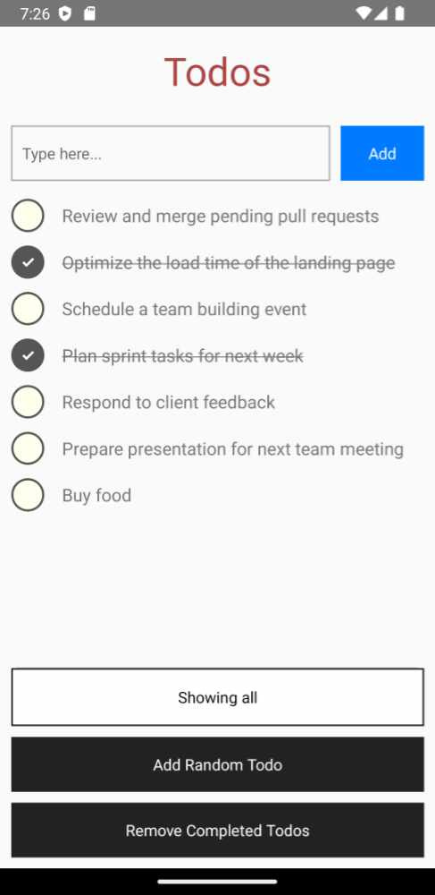

# Todo App (React Native)

A small React Native mobile app (TypeScript), to show how to write end-to-end BDDs with the
**Easy BDD Tool** and [Detox](https://wix.github.io/Detox/).



The BDDs in `e2e/bdd.TodoList.e2e.ts` test the app through its UI, on an Android emulator or
device. Each step types, taps and checks what's on the screen.

## Running the end-to-end tests

1. Start an Android emulator, or connect a device.
2. Build the app, with the Detox test code: `npm run e2e:build`
3. Run the tests: `npm run e2e:test`

This uses the release build, which has the JavaScript inside it. To use the debug build instead,
start Metro with `npm start`, and then run `npx detox build -c android.debug` and
`npx detox test -c android.debug`.

The **Easy BDD Tool** Jest reporter writes the feature files into `e2e/gen_features/`, and the
Cucumber results into `e2e/gen_cucumber_results/`.

## How Detox was added

* `npm install --save-dev detox`
* `.detoxrc.js` is the Detox configuration, and `e2e/jest.config.js` is the Jest configuration
  of the end-to-end tests.
* The Android project was changed as described in the
  [Detox project setup](https://wix.github.io/Detox/docs/introduction/project-setup): see
  `android/build.gradle`, `android/app/build.gradle`, `DetoxTest.java`, and
  `network_security_config.xml`.
* The text field and the filter button have a `testID`, so that the tests can find them.

iOS is not configured for Detox in this example.

## Note for Windows

If the build fails with `Filename longer than 260 characters`, move the project to a folder with a
shorter path. React Native's native build creates very long file paths.

## Running the app

```
npm install
npm run android
```

## Dependency

This app is inside the **Easy BDD Tool** repository, so its `package.json` uses the local version:
`"easy-bdd-tool-jest": "file:../.."`. In your own project, use the version from npm instead.
