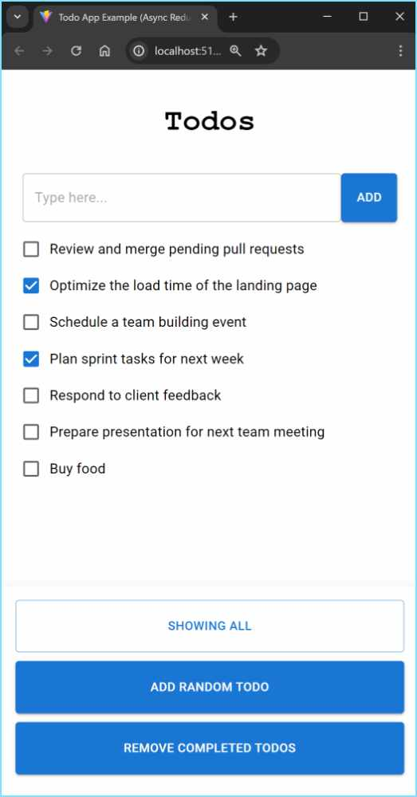

# Todo App (web)

A small React web app (Vite + TypeScript), to show how to write BDDs with the **Easy BDD Tool**.



It has two kinds of BDDs:

* `__tests__/bdd.*.test.ts` test the business rules of the app (its state and actions), without
  the UI. Run them with `npm test`.

* `e2e/bdd.TodoList.e2e.ts` test the app through its UI, in a real browser, with
  [Playwright](https://playwright.dev). Each step types, clicks and checks what's on the page.
  Run them with `npm run e2e`. The first time, install the browser with
  `npx playwright install chromium`.

## How the end-to-end tests work

* `e2e/jest.config.js` is the Jest configuration of the end-to-end tests.
* `e2e/startApp.mjs` serves the app with Vite before the tests run, and `e2e/stopApp.mjs` stops it.
* The test file opens the browser before the tests, and a new page for each scenario, so that each
  scenario starts with no todos.
* The **Easy BDD Tool** Jest reporter writes the feature files into `e2e/gen_features/`, and the
  Cucumber results into `e2e/gen_cucumber_results/`.

## Running the app

```
npm install
npm run dev
```

## Dependency

This app is inside the **Easy BDD Tool** repository, so its `package.json` uses the local version:
`"easy-bdd-tool-jest": "file:../.."`. In your own project, use the version from npm instead.
